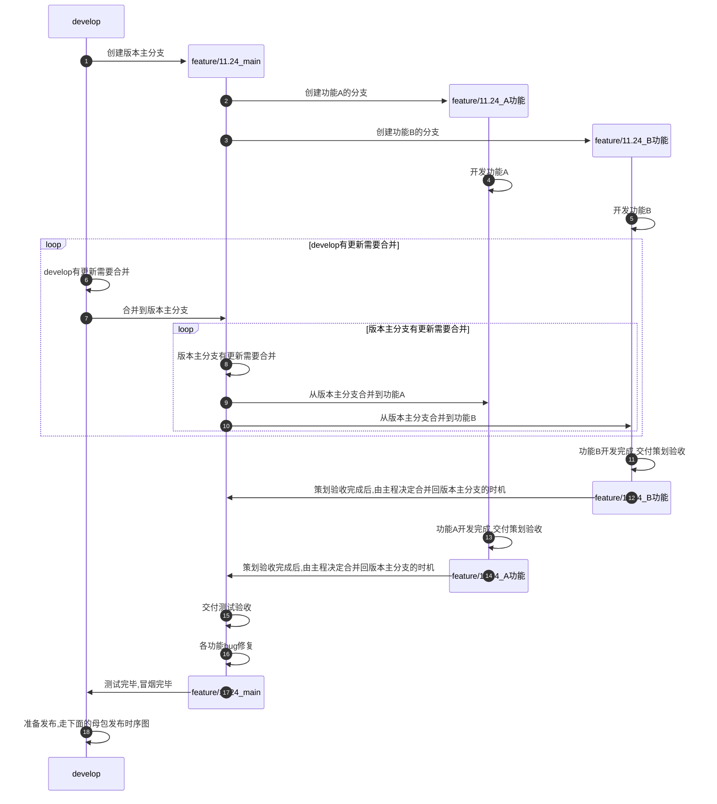
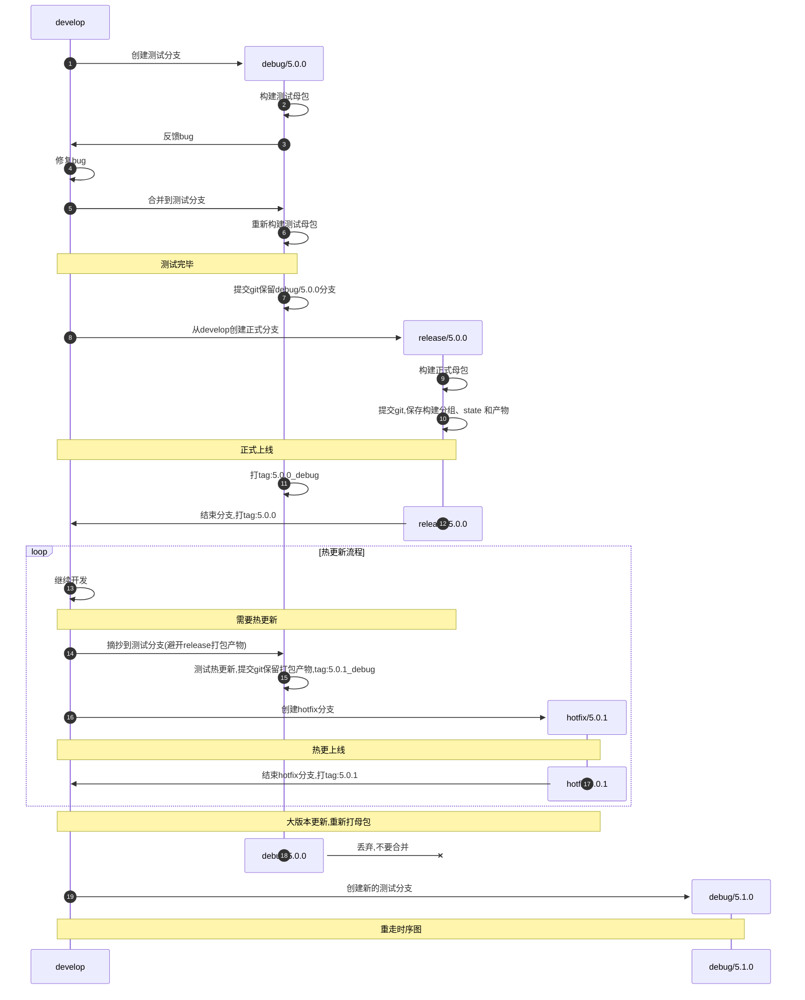

# 基于 Gitflow 的版本发布工作流


### 1 开发时序图



###

### 2 母包发布时序图



## 3. 摘取业务提交时的隔离规则

### 3.1 debug 摘取前必须排除什么

**不要直接 cherry-pick 正式版本的构建提交，也不要把 release、master 或 hotfix 整支合并到 debug。** 分支名不会保护文件，Git 也不会自动跳过 state 或资源组。

| 修改内容 | 是否直接摘取到 debug | 正确处理方式 |
|---|---|---|
| 经批准的业务资源、配置表及依赖 | 可以 | 保持与本次正式发布目标相同的业务内容 |
| 业务资源的 `.meta`，包括新增、移动和删除涉及的元数据 | 需要一起处理 | 保留资源 GUID，不能按扩展名一律排除所有 `.meta` |
| 正式 `AssetGroups`、`Schemas`、Settings、DataBuilders、组模板及其 `.meta` | **禁止** | 保留 debug 自己的配置，由 debug 的热更流程在其基础上更新 |
| 正式 `addressables_content_state.bin` 及其 `.meta`，任何目标平台 | **禁止** | 保留 debug 对应平台的原始测试母包 state |
| 业务和正式组配置、state 混在一起的提交 | **禁止整笔摘取** | 在来源处拆成纯业务提交，或在临时分支中整理成可审核的纯业务补丁 |
| 有意改变资源的 Address、Labels | 不复制整份正式组文件 | 记录资源 GUID 和目标 Address、Labels，在 debug 自己的条目中落实相同业务含义 |
| `ConfigHMAddressables` 中新增资源目录 | 按字段审核 | 同步必要的业务目录；保留目标分支的服务器地址和既定打包设置 |
| Provider、加密、preset、打包模式、Unity 或 Addressables 版本 | 不作为普通业务修改摘取 | 按母包兼容性评估；需要改变框架或构建基础时进入新母包流程 |

`Assets/AddressableAssetsData/` 应作为跨环境摘取的默认排除范围。该规则禁止的是**导入另一环境的构建配置**，不禁止 debug 自己的热更工具创建更新组、移动条目并保存配置。

当前 `UpdateAASetting` 会再次读取 HMAA 平台配置并应用 Schema/preset。因此，只有排除 `Assets/AddressableAssetsData/` 还不够；也要审核该目录外的平台配置，尤其是服务器地址、`ForceRemoteAssetsToLocal`、重复依赖组策略和加密 Provider。

### 3.2 让摘取过程容易检查

把“业务修改”和“某环境构建后生成的配置”分成不同提交，例如 `biz: 调整角色资源` 与 `build(debug): 保存 5.0.1 更新组`。正式分支和 debug 可以对应同一个业务来源提交，但分别拥有自己的构建提交。

摘取前先查看每笔提交的文件清单与实际差异。只有确认是纯业务提交后才执行摘取；`cherry-pick` 默认处理整笔提交，`-x` 只记录来源，不会过滤文件。见 [Git cherry-pick 文档](https://git-scm.com/docs/git-cherry-pick)。

以下命令是人工检查示例，`业务提交ID`、`摘取前提交ID` 需要替换成实际值：

```text
git status --short
git show --format=fuller --name-status 业务提交ID
git show 业务提交ID
git cherry-pick -x 业务提交ID
git diff --name-status 摘取前提交ID HEAD
git diff 摘取前提交ID HEAD -- Assets/AddressableAssetsData
```

最后一项应能证明没有导入正式构建数据。业务资源导入后，如果移动回调更新了 debug 自己的 Address，需要区分这些本地同步修改与来源提交携带的正式组替换；不能把两者混为一谈。热更构建完成后的更新组变化也应单独保存和审核。

发生冲突时不使用“一律采用来源分支”的方式处理 Addressables 目录。若已误带入正式数据，先停止构建和发布，再依据摘取前 debug 的记录恢复受影响配置。不要用重新打测试母包掩盖问题，否则原测试客户端与 state 的对应关系会改变。

