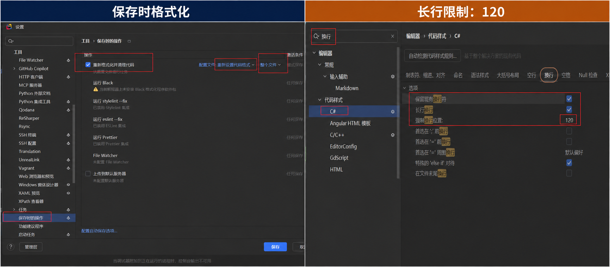
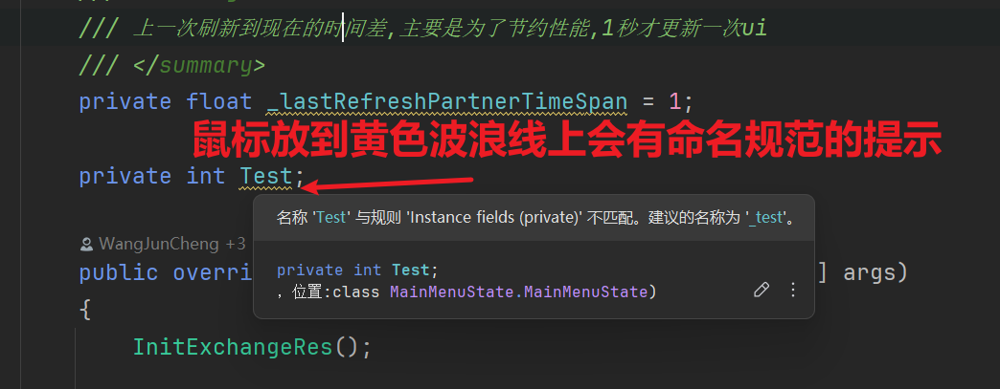
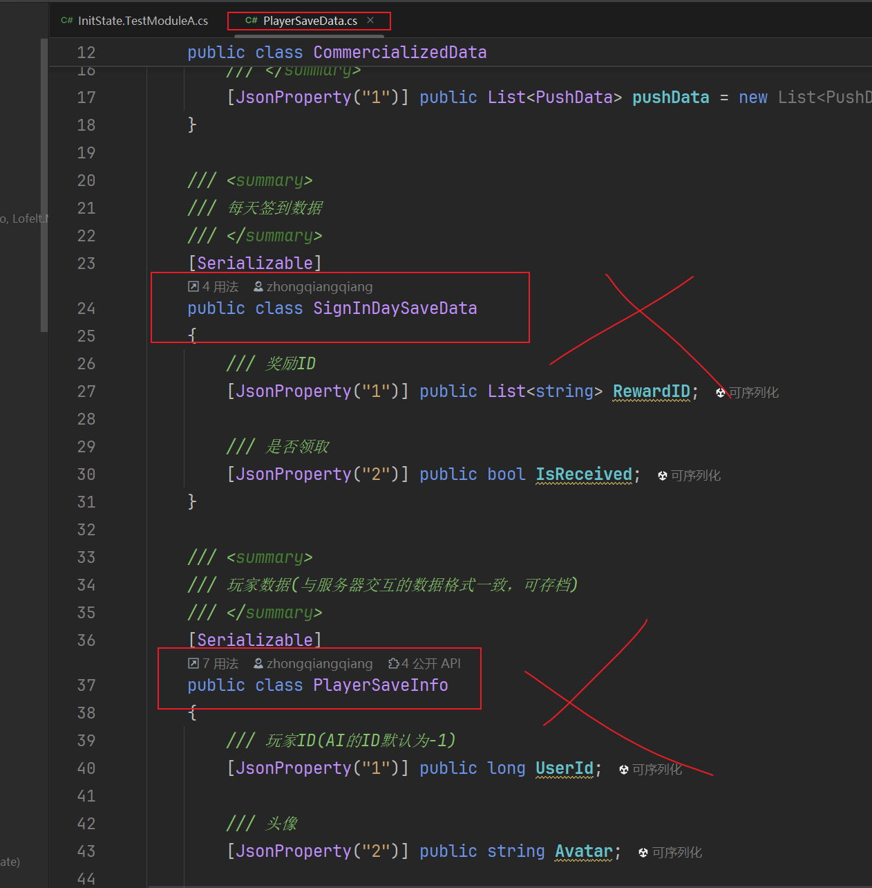
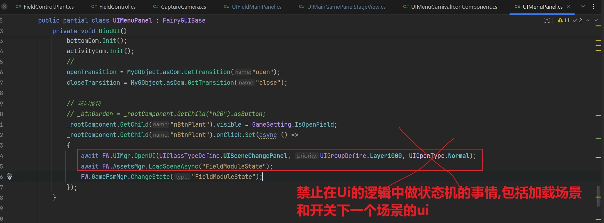

# Unity C# 代码规范（公司级）

| 文档属性 | 内容 |
|---|---|
| 适用范围 | 公司内部使用 C# 的 Unity 项目、共享 Unity Package 与工具仓库 |
| 文档级别 | 公司工程基线 |
| 文档状态 | 分发基线；已有项目以其有效版本为准 |
| 版本 | 1.9 |
| 最近更新 | 2026-11-27 |
| 归口角色 | 公司 Unity 技术委员会或授权技术负责人 |
| 复审周期 | 每 12 个月，或 Unity LTS、C# 版本及核心工具链升级时 |
| 配套文档 | [Unity 工程代码结构规范](CodeStructureGuide.md) |

## 1. 目的、适用范围与优先级

本规范用于统一公司 Unity 项目的可读性、可维护性和协作方式，不依赖任何具体游戏、框架、UI
方案、资源系统或热更新方案。

规则优先级如下：

1. 法律、安全、平台和发布要求；
2. 本公司级规范；
3. 项目在 `AGENTS.md`、`PROJECT_CONVENTIONS.md` 或同类文件中明确记录的补充规则；
4. 模块局部约定。

项目规则可以收紧公司规范。确需偏离公司规范时，必须写明适用范围、原因、负责人和退出条件；历史代码
本身不是例外依据。第三方源码、自动生成文件和供应商代码遵循其来源规则，不因格式统一而直接改写。

本文使用以下约束词：

- **必须 / 禁止**：评审和自动检查应阻止违反项合入；
- **应 / 建议**：默认做法，偏离时应能说明理由；
- **可以**：根据项目场景选择。

## 2. 自动化与格式化基线

### 2.1 配置即规则

- 每个项目必须在仓库根目录提交 `.editorconfig`，并把可自动执行的格式规则写入其中。
- 新项目可以从 [Unity 项目 `.editorconfig` 模板](UnityProject.editorconfig.template) 起步：复制到项目根目录并
  重命名为 `.editorconfig`。启用前按项目实际路径核对生成、第三方和缓存目录的排除范围；
  模板部署方式见分发包的项目接入说明，不能照搬其他工程路径。
- IDE 设置、格式化工具和 CI 应读取同一份配置，避免仅依赖个人 IDE 导出文件。
- 团队使用的 Rider 或其他编辑器必须支持 `.editorconfig`，格式结果必须一致。
- 项目升级 C#、Unity 或分析器版本时，应单独评审格式和诊断变化。

### 2.2 基础排版

- C# 源文件、手写文档和配置文件统一使用 UTF-8（无 BOM）。项目文本默认使用 LF；Windows 批处理文件（`.bat`、`.cmd`，含大小写扩展名）使用 CRLF。项目 `.editorconfig` 的保存行尾与 `.gitattributes` 的检出行尾必须一致。
- 缩进使用 4 个空格，不使用制表符表达代码层级。
- 使用 Allman 花括号风格，控制语句始终写花括号。
- 一行一个语句，一行一个声明。
- 单行建议不超过 120 个字符；在参数、逻辑运算符或方法链的语义边界换行。
- 连续空行不超过一行；禁止行尾空格。
- `using` 放在命名空间外，`System.*` 在前，其余按字母顺序排列。
- 始终显式声明成员可见性。



*图 1：IDE 设置仅用于演示；公司规则的可执行来源应是仓库中的 `.editorconfig`。*

```csharp
using System;
using UnityEngine;

namespace Inventory
{
    /// <summary>根据物品 ID 刷新界面中的物品信息。</summary>
    public sealed class ItemPresenter : MonoBehaviour
    {
        [Tooltip("要在界面中展示的物品 ID。")]
        [SerializeField] private string _itemId;

        /// <summary>刷新当前物品的显示内容。物品 ID 为空时记录错误并停止刷新。</summary>
        public void Refresh()
        {
            if (string.IsNullOrWhiteSpace(_itemId))
            {
                Debug.LogError("无法刷新物品：物品 ID 为空。", this);
                return;
            }

            // 此处仅展示排版，省略项目的界面刷新实现。
        }
    }
}
```

## 3. 命名规范

### 3.1 命名总表

| 对象 | 规则 | 示例 |
|---|---|---|
| 类、结构体、记录、委托 | PascalCase，使用名词或名词短语 | `InventoryService` |
| 接口 | `I` + PascalCase | `IInventoryRepository` |
| Attribute 类型 | PascalCase + `Attribute` | `ItemIdAttribute` |
| 方法 | PascalCase，使用动词或动词短语 | `LoadInventoryAsync` |
| 属性 | PascalCase，使用名词或状态 | `CurrentItem` |
| 事件 | PascalCase，描述已经发生的事实 | `InventoryChanged` |
| 枚举类型 | PascalCase；普通枚举用单数，Flags 枚举用复数 | `ItemState`、`ItemPermissions` |
| 枚举成员 | PascalCase | `Unavailable` |
| 常量 | UPPER_CASE，单词之间使用下划线 | `DEFAULT_CAPACITY` |
| 参数、局部变量 | camelCase | `itemConfig` |
| 私有/内部实例字段 | `_` + camelCase | `_currentItem` |
| 私有静态字段 | `_` + camelCase | `_sharedCache` |
| 内部静态字段 | `s_` + camelCase | `s_sharedCache` |
| 线程静态字段 | `t_` + camelCase | `t_buffer` |
| 类型参数 | `T` 或 `T` + 语义名 | `T`、`TConfig` |
| Unity 序列化私有字段 | `_` + camelCase | `_itemPrefab` |



*图 2：IDE 会按命名规则给出提示和改名建议；命名规则的最终来源是仓库配置，不是个人 IDE 设置。*

### 3.2 命名语义

- 标识符使用英文和通用技术缩写，优先清晰而不是短小。
- 禁止使用无语义名称，如 `Data1`、`Temp2`、`ManagerNew`、`UtilsEx`。
- 布尔值应表达真假问题，优先使用 `Is`、`Has`、`Can`、`Should` 等前缀。
- 异步方法以 `Async` 结尾；Unity 消息、接口实现和事件处理器可按既有签名例外。
- 集合使用复数或集合语义名称；单个对象不用复数。
- 缩写按单词处理，例如 `HttpClient`、`UiState`；平台或第三方 API 的固定拼写保持原样。
- 禁止把人员姓名、日期或序号作为长期代码所有权标识。

### 3.3 兼容名称

序列化字段、资源路径、协议字段、存档键和公开 API 可能构成兼容契约。修改此类名称前必须确认迁移策略；
不能仅为了符合命名规范破坏现有数据。项目级兼容名称必须被明确标注，不得复制到新设计中。

## 4. 文件、命名空间与类型组织

### 4.1 单文件单主类型

一个 `.cs` 文件原则上只定义一个顶层主类型，文件名与主类型名一致。允许的例外仅包括：

- 与主类型紧密绑定且很短的私有嵌套类型；
- 同一抽象的必要泛型或非泛型配对；
- 自动生成文件；
- 项目规范明确允许的单例访问扩展等强关联类型。

不要把多个无关 DTO、枚举或工具类堆放在同一文件中。



*图 3：反面示例。同一文件中堆放了多个无关 DTO，应各自独立成文件。*

### 4.2 命名空间

程序集命名与命名空间映射统一见[工程结构规范 §6、§7](CodeStructureGuide.md#7-命名空间与程序集映射)。
本模板默认使用块范围命名空间；已有项目按有效 `.editorconfig` 和 Unity 工具链支持的语法执行，不因普通功能修改切换语法。

### 4.3 partial 文件

`partial` 用于生成代码配套、平台差异或同一类型的清晰职责拆分，不用于隐藏过大的类。

```text
<TypeName>.<Responsibility>.cs
```

示例：

- `PlayerController.Input.cs`
- `PlayerController.Animation.cs`
- `InventoryPanel.Binding.cs`

只有片段具有独立状态、生命周期或职责边界时才评估拆成新类型。不能仅因逻辑能搬出去就拆类，也不要求每个新功能新增 partial。

## 5. API 与类型设计

- 默认使用最小可见性；跨程序集调用、框架约定、Unity 事件或反射等确实要求公开时才声明为 `public`，说明对应消费者。
- 优先使用属性表达状态，避免公开可变字段。
- 优先组合而不是深继承；继承层级应保持浅且职责明确。
- 一个类型只承担一组高度相关的职责；避免无边界的 `Manager`、`Helper` 和 `Utils`。
- 构造函数或初始化方法必须建立有效对象，不让对象长期处于“半初始化”状态。
- 对外 API 明确空值、所有权、线程和生命周期约束。
- 可不变的数据优先使用 `readonly`、只读接口或不可变值对象。
- 不返回可被外部随意修改的内部集合；按需要返回只读视图、快照或受控操作接口。
- 参数构成稳定、内聚的业务概念时可以使用参数对象；不按参数数量机械创建包装类型，不使用无语义元组跨越公共 API。
- 对模块外调用的公共 API，须用简洁的 XML 注释说明用途，并按需写明参数、返回值、单位、坐标、对输入的修改、所有权、取消条件和失败行为。私有方法不堆模板注释。
- 查询不暗中重建或修改状态；修改操作的副作用明确。失败使用有定义的结果或异常，不吞异常后返回貌似成功的数据。
- 数据类型记录数据和必要查询；Window、Inspector 负责配置与交互，复用业务实现，不各自承载或复制完整算法。

### 5.1 面向对象设计与中文注释

AI 编写或修改 C# 代码时，遵循以下要求。

- 编写面向对象代码时，应结合实际需求运用以下原则。根据当前职责和依赖决定是否引入接口、基类或其他抽象。
  - **单一职责**　把因同一业务原因而变化的逻辑放在一起。例如，界面布局和存档格式可以独立变化，应由不同的类负责。
  - **开闭原则**　对已经明确的扩展需求，优先让新实现接入现有流程，减少对已验证逻辑的修改。
  - **里氏替换**　子类型应接受基类型允许的输入，满足基类型对结果和行为的约定，使调用方可以直接替换实现。
  - **接口隔离**　按调用方需要的能力划分接口。例如，只查询背包的界面应只依赖查询接口。
  - **依赖倒置**　需要隔离实现细节时，让业务逻辑依赖表达业务需求的接口，由具体实现满足该接口。例如，存档流程依赖存档读写接口，文件存储类实现这个接口。
  - **迪米特法则**　对象应优先与直接协作的对象通信。例如，界面可向背包查询物品数量，避免逐层访问背包内部的容器和列表。
- 每个类都必须在声明上方用中文 XML 文档注释（`<summary>`）说明职责，包括非公开类和嵌套类。
- 所有公共方法、属性和字段都必须在声明上方写中文 XML 文档注释，即使只在模块内部使用。方法说明执行什么操作，属性和字段说明值的含义。
- Inspector 中的字段和属性沿用自身名称。所有在 Inspector 中展示的序列化字段都必须添加 `[Tooltip("中文说明")]`，包括公开字段和标有 `[SerializeField]` 的私有字段。自定义 Inspector 绘制字段或属性时，必须为对应控件提供中文悬停提示。公开成员同时保留源码中的 XML 注释。
- 业务主流程、关键状态切换、复杂算法等重要方法，无论访问级别，都必须在源码中用中文伪代码或简短说明写清主要步骤、关键分支和结果。
- 中文注释、流程说明和悬停提示必须简短、明确。直接写出职责、行为或影响，按需注明单位、范围或生效条件。例如，攻击间隔可写为“两次攻击之间至少等待的秒数”。
- 修改代码时，如果类或方法的职责、参数、返回值、执行流程，或属性和变量的含义、单位、范围发生变化，必须在同一次修改中更新受影响的中文注释、伪代码和 Inspector 悬停提示，并核对说明与实际行为一致。

## 6. 静态成员、全局状态与依赖

- 禁止新增无所有者、无生命周期的全局可变状态。
- 静态类适用于纯函数、扩展方法、常量或进程级基础设施；不得成为任意业务逻辑的容器。
- 单例必须说明创建时机、销毁时机、线程模型、测试替换方式和跨场景行为。
- 业务依赖应通过构造、初始化参数、序列化引用或项目批准的容器显式提供。
- 禁止使用 Service Locator 掩盖任意依赖；项目采用门面或容器时，应限制在组合根和明确的跨系统入口。
- 禁止从底层模块反向访问 UI、场景对象或具体玩法实现。

## 7. Unity 类型与生命周期

### 7.1 MonoBehaviour

- 只有需要 GameObject、组件生命周期或 Unity 回调的类型才继承 `MonoBehaviour`。
- 不在构造函数中访问 Unity API；依赖获取和状态建立放在明确的生命周期或初始化方法中。
- `Awake` 建立本对象内部引用，`OnEnable` 注册临时监听，`Start` 执行依赖其他对象的首次流程，
  `OnDisable` 注销监听，`OnDestroy` 释放最终资源。项目可以细化，但必须保持成对和可预测。
- 禁止依赖同一帧中不同 GameObject 的隐含回调顺序；必须排序时使用显式编排或 Script Execution Order。
- 高频路径中缓存组件引用，避免在 `Update`、`LateUpdate` 或 `FixedUpdate` 中重复查找。
- 不需要逐帧执行时不要保留空的 Unity 消息方法。

### 7.2 ScriptableObject

- `ScriptableObject` 适合共享配置、编辑器资产和可组合的数据定义。
- 默认把运行时可变状态与只读配置分开，避免在资产对象上留下 Play Mode 污染。
- 不把 `ScriptableObject` 当作无边界全局单例；其加载、缓存和释放方式由项目资源方案定义。
- 明确设计为可变的数据资产必须有角色与所有者；不把所有 ScriptableObject 一概禁止写入，也不为隔离状态复制大资源。

### 7.3 UI 与业务

- UI 层负责呈现、输入和视觉状态，不负责计费、奖励、存档、关卡规则等核心业务决策。
- 业务层不得依赖具体 UI 控制器；跨层通过应用服务、命令、事件或稳定数据契约通信。
- UI 生命周期同样适用 §9 的订阅与异步规则、§12 的资源所有权规则。



*图 4：反面示例。UI 的按钮回调中直接加载场景并切换状态机，这类流程应交给业务层发起。*

## 8. Unity 序列化与数据兼容

- Inspector 字段默认写成 `[SerializeField] private`，不要为显示在 Inspector 中而公开字段。中文提示的写法见[第 5.1 节](#51-面向对象设计与中文注释)。
- Unity 序列化字段不能依赖属性 setter 执行校验；必要时在 `OnValidate` 或显式初始化中校验。
- 不序列化缓存、可推导数据和重复数据。
- 重命名已经落盘的 Unity 字段时使用迁移机制并验证 Prefab、Scene 和资产；不能只改 C# 名称。
- 使用 `[SerializeReference]` 前必须确认确实需要多态、共享引用或空值语义，并评估兼容性。
- 存档或网络数据必须有独立版本策略；字段编号、键名和枚举数值一旦发布即视为协议。
- 反序列化旧数据后必须经过默认值补齐和合法性校验。
- Inspector 编辑优先通过 SerializedObject/SerializedProperty，正确处理 Undo、Prefab 覆盖及支持的多对象编辑。直接修改对象或场景时记录相应 Undo、Prefab 修改与脏标记；只读浏览不写入对象。
- 编辑器 Undo 不等于导出文件回滚；导出的备份、迁移和失败清理按已确认的输出契约处理，不自动建立事务系统。

Unity 序列化直接处理字段而非普通属性，并对可序列化类型有专门限制；设计数据模型时必须以项目使用的
Unity 版本文档为准。

## 9. 异步、事件与生命周期

### 9.1 异步

- 每个项目必须选定并记录主要异步抽象，例如 `Task`、协程或经批准的第三方方案；同一模块不得随意混用。
- I/O 或可等待流程不得阻塞主线程；禁止使用 `.Wait()`、`.Result` 或忙等待代替异步。
- 能返回可等待对象的方法不得使用 `async void`；Unity 事件签名等无法改变的入口必须捕获并记录异常。
- 长生命周期异步操作应绑定调用方、组件或场景的生命周期。支持取消的操作传递取消信号；底层不能取消时必须拒绝过期结果，并明确迟到资源的释放责任。取消请求不等于操作已经结束。
- 继续执行 Unity API 前必须确认运行线程和目标对象仍有效。
- 明确谁等待任务、谁处理异常，不随意丢弃任务。取消信号沿调用链传递，取消不冒充业务成功或失败。
- 没有明确线程安全保证的 Unity 对象/API 只在主线程访问。async 不代表后台线程；Jobs 及有线程安全保证的 API 按其契约使用。
- 并行执行前确认任务彼此独立；共享状态写入必须显式同步或回到主线程。

### 9.2 事件

- 事件名描述已经发生的事实，命令名描述希望发生的动作。
- 注册与注销必须成对；优先让订阅关系跟随对象生命周期。
- 防止重复注册和销毁后回调；需要取消订阅的匿名委托保留对应引用。
- 全局事件只用于真正需要解耦或一对多通知的场景，不替代普通方法调用。
- 事件载荷使用稳定的数据契约，不传递具体 UI 控制器或可任意修改的内部集合。
- 事件处理顺序若影响正确性，应改用显式编排，不依赖订阅先后。

## 10. 异常、日志与诊断

- 只捕获能够处理、补充上下文或转换边界的异常；禁止空 `catch`。
- 避免无筛选捕获 `Exception`；确需作为顶层保护时必须完整记录并定义后续状态。
- 参数错误在边界尽早失败；可恢复的外部数据错误记录上下文并返回明确结果。
- 日志包含操作、关键标识、状态和失败原因，不只写“失败”或“出错”。
- 日志级别按影响选择；高频循环中禁止持续输出普通日志。
- 禁止记录密码、令牌、完整个人信息或其他敏感数据。
- 面向线上诊断的重要流程应提供稳定的错误码、事件或指标，而不是依赖临时日志文本。

## 11. 性能与内存

- 先使用目标设备上的 Profiler、Memory Profiler 或可重复基准定位瓶颈，再进行优化。
- 在每帧、物理帧、动画和大批量循环等热路径中避免不必要分配、装箱、闭包和重复查询。
- 缓存必须有失效和清理策略；不得用永久缓存掩盖资源所有权问题。
- 对象池只用于已经证实的高频创建销毁场景，并定义重置、容量和异常回收规则。
- 优先可读且正确的实现；性能特例必须有测量结果和注释说明。
- 按实际工作单元控制峰值，避免无需求的全量复制、重复计算与逐帧扫描。没有测量不宣称性能提高或内存下降；推算标明前提。

## 12. 资源与对象所有权

- 项目必须指定唯一的主要运行时资源加载入口，并记录同步/异步、引用计数和释放规则。
- 谁申请资源，谁负责释放，或把所有权明确移交给更长生命周期的对象。
- 借用不等于拥有；取消和失败应清理自己持有的临时资源，不能销毁共享资产。
- 禁止绕过统一资源系统建立不可追踪的第二套缓存。
- `Resources` 只放确需通过其 API 加载的少量资产；`StreamingAssets` 用于以原始文件随包发布的内容，并处理平台访问差异。平台原生路径按其明确用途使用，不作为通用资源目录。
- 场景切换、取消和异常路径必须与成功路径一样释放资源。
- 判断 `UnityEngine.Object` 原生对象是否有效时使用 Unity 的 `== null` 或布尔语义，不能等价替换为 `?.`、`??`、`is null` 或 ReferenceEquals。普通 C# 对象仍按普通空引用处理。

## 13. 生成代码、第三方代码与平台代码

- 生成文件必须带可识别标记，并说明生成器、输入源和是否允许手改；目录和提交策略统一见[工程结构规范 §8.4](CodeStructureGuide.md#84-generated)。
- 禁止直接修改会被生成器覆盖的文件；需要变更时修改模板、输入或 partial 扩展。
- “工具首次生成、后续不覆盖”的脚手架文件属于可维护源码，标记必须与完全生成文件区分。
- 第三方源码放在独立目录或 Package 中，尽量不改；必须修改时记录版本和补丁。
- 平台差异优先通过程序集平台设置和适配层隔离，减少散落的条件编译。

## 14. 质量验证与变更范围

- 核心规则和缺陷修复应有正常、边界及相关失败情形的验证依据。纯业务适合 Edit Mode 测试；帧、场景和生命周期行为适合 Play Mode 测试。按风险选择已有测试、批准新增的测试或明确的人工步骤，不为低影响改动机械增加测试文件。
- 测试代码遵守生产代码的可读性要求，避免依赖共享可变状态和执行顺序。
- 质量要求与执行授权是两件事。上述要求不授权 AI 新增测试工程、运行 Unity、编译、测试、构建、导入或提交；执行者遵守当前任务和适用用户级配置的权限限制。未做的验证列为待验证项，不据此宣称完成验收。
- 每次变更聚焦一个目的；格式化、重命名、结构迁移和行为修改尽量分开，不顺手进行无关风格迁移。
- 交付说明列出行为变化、兼容影响、实际检查及未验证事项。

## 15. 历史代码与迁移

- 新代码遵守本规范；旧代码不因本规范发布而自动触发全量整改。
- 修改旧文件时优先保持改动聚焦；局部风格能安全统一时再处理。
- 涉及命名空间、程序集、资源路径、序列化字段或公开 API 的迁移必须独立设计并可回滚。
- 长期例外登记在项目规范或技术债清单中，写明负责人和退出条件。
- 禁止把历史例外复制为新模块模板。

## 16. 开发自检与目录级规范性审核

日常开发自检核对本次实现与需求、契约、技术规范的一致性。“代码评审”默认还检查功能和逻辑；只有明确要求“规范性审核”时，才使用本节的专门范围。不要把每次实现都变成一次正式目录审核。

### 16.1 范围与输入

规范性审核默认只读：核对格式、命名、类型组织、程序集归属、依赖方向及明确的项目条款，不修改被审文件。业务正确性、运行、性能和测试充分性不属于其结论；发现范围外问题可以简短提示，不能冒充规范证据。

先确认目标、可比较基线、公司规范、项目补充和实际 `.editorconfig`。缺少 Git 基线时做“快照规范性审核”，不把旧问题算成本次引入。缺少关键文件或归属证据时说明信息不足。

检查目标内手写源码、程序集资产和相关配置；为确认调用边界、partial 或归属，可以读取必要的目录外文件并说明范围。完全生成文件、未改的第三方只核对来源、排除范围及是否被错误手改。

### 16.2 检查与证据

1. 区分手写、生成、第三方、Editor、Tests 和配置，确定适用规则。
2. 完成当前任务允许的静态检查；工具不可用或动作未获授权时记录未验证项，不自动修复或启动 Unity。
3. 核对命名、类型、可见性、注释及[结构审核证据](CodeStructureGuide.md#14-目录级结构规范性审核)。
4. 区分本次问题、已登记例外和无关历史问题，按证据给出结论。

实际 `.editorconfig` 才是项目自动化基准，[模板](UnityProject.editorconfig.template) 只是起点。它可表达文本和部分命名规则，不能证明实际程序集归属、资源所有权或功能正确。记录用过的工具、范围和结果；未运行分析器时不得声称格式或命名诊断全部通过。

单条问题写清：**位置、规则、实际证据、具体影响、最小修改建议、是否本次引入**。不能只写“建议优化”，也不能用规范建议扩张为功能重写。

### 16.3 级别与结论

| 级别 | 含义 | 处理 |
|---|---|---|
| P0 | 关键结构边界失效，无法继续可靠审核 | 先修复或补齐关键证据 |
| P1 | 明确违反必须/禁止条款 | 整改前不通过 |
| P2 | 偏离建议条款，有具体维护影响 | 处理或由负责人说明接受 |
| P3 | 可选改善，没有违反规则 | 不阻断 |

结论使用“规范性审核不通过”“规范性审核有条件通过”“规范性审核通过”或“信息不足”。未解决 P0/P1 为不通过；没有 P0/P1、P2 尚待接受为有条件通过；必要检查齐备且 P2 已处理或接受才是通过。IDE 的 suggestion 强度不自动决定问题级别。

通过仅表示已检查范围符合规范，不等于业务、编译或运行通过。历史问题只有被本次复制、扩大，或妨碍判断本次归属时才阻断；其他问题单列，不借机全量整改。

### 16.4 输出与复核

默认在聊天中给出目标与基线、结论、问题及建议、实际检查和未验证项。只有用户要求保存或项目已有明确报告要求时才写文件；优先更新已有报告或放入项目文档目录，不默认向 Assets 写审核文档，也不按文件拆出大量报告。

复核先读取已改文件及原结论，再确认原问题是否解决；不能仅凭用户说“改好了”或原行消失就认定通过。已有报告原地更新，保留首次审核时间、历史问题、整改状态及复核证据，新增最近审核时间；使用任务时区。可以用删除线表示已解决，但不重复抄录整份历史。

自然语言“对这个目录做规范性审核”“复核上次规范问题”即可触发；不要求固定命令。未保存过报告时可用聊天中的原结论，既无报告也无原结论则按首次审核处理。

## 17. 参考资料与取舍

本规范综合以下公开资料的结构与原则，并结合 Unity 项目特点重新编排；未照搬任何单一来源：

- [Microsoft：Common C# coding conventions](https://learn.microsoft.com/en-us/dotnet/csharp/fundamentals/coding-style/coding-conventions)
- [Microsoft：C# identifier naming rules](https://learn.microsoft.com/en-us/dotnet/csharp/fundamentals/coding-style/identifier-names)
- [.NET Runtime：C# Coding Style](https://github.com/dotnet/runtime/blob/main/docs/coding-guidelines/coding-style.md)
- [Google：C# Style Guide](https://google.github.io/styleguide/csharp-style.html)
- [Unity：Script serialization](https://docs.unity3d.com/2022.3/Documentation/Manual/script-Serialization.html)
- [Unity：Assembly definitions](https://docs.unity3d.com/2022.3/Documentation/Manual/ScriptCompilationAssemblyDefinitionFiles.html)
- [Unity：Test Framework](https://docs.unity3d.com/2022.3/Documentation/Manual/testing-editortestsrunner.html)
- [Unity 公开示例：Unity C# style guide](https://github.com/thomasjacobsen-unity/Unity-Code-Style-Guide)

主要取舍：格式采用 .NET Runtime 常用的 Allman、4 空格与显式可见性，并采用 Google 对清晰命名和一致性
的强调；常量采用公司既有 Unity 约定 `UPPER_CASE`，私有实例及私有静态字段使用 `_camelCase`，内部静态
字段使用 `s_camelCase`。程序集与命名空间同样采用公司既有约定：单层 PascalCase、同名映射，不采用公开
示例中常见的公司/产品多层前缀。Unity 专属规则以项目目标 Unity 版本的官方手册为准。项目已有不同约定时，
必须作为项目级兼容例外明确记录。
